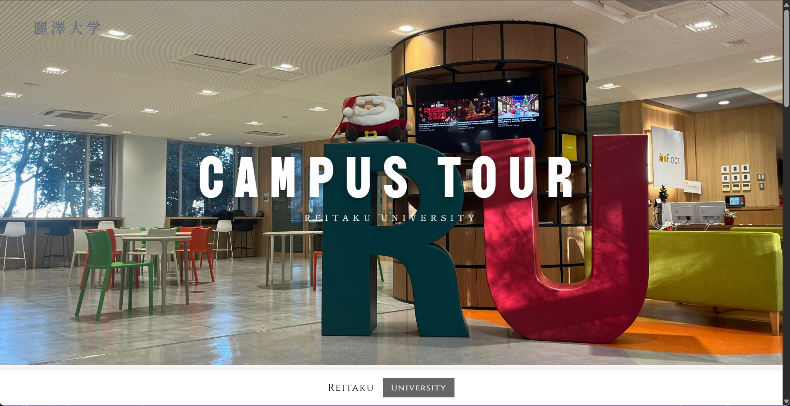
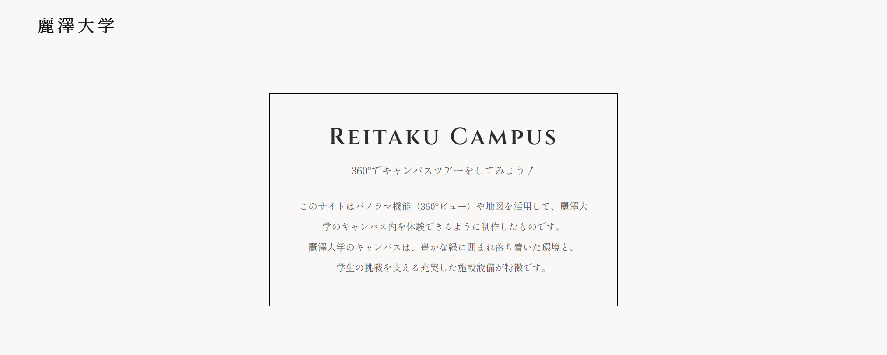
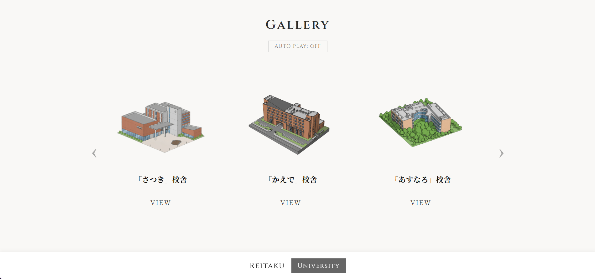
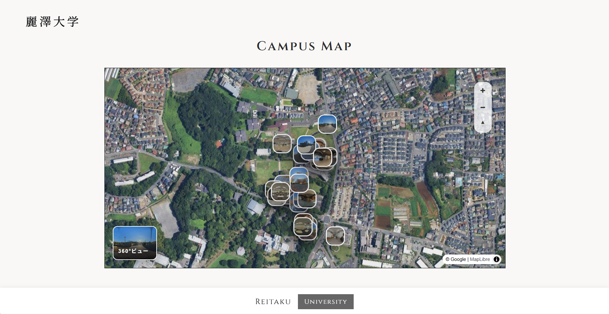
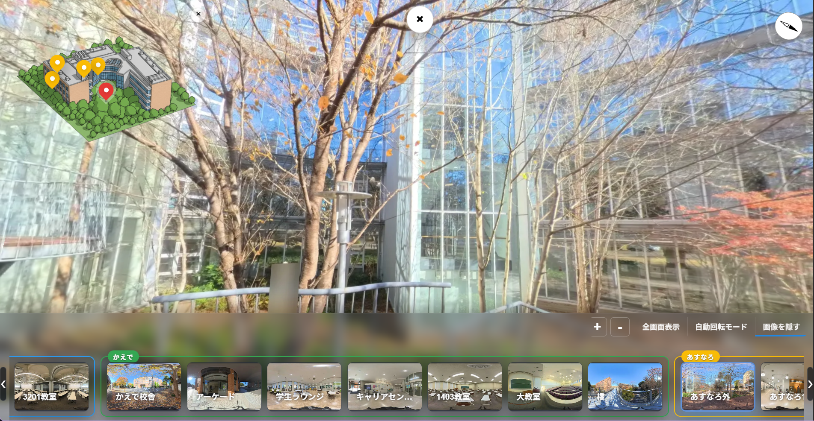

<h1 align="center">🌳 Reitaku Campus</h1>

    

    
    

    
    

---

# About

🗺️本サイトは、麗澤大学のキャンパスを360°ビューで紹介するウェブサイトです。キャンパス内の様々な場所を360°の視点で見ることができ、まるで実際にキャンパスを歩いているかのような体験ができます。

ゼミナールのプロジェクトの一環で、制作しました。キャンパスの魅力を多くの人に伝えることを目的としています。

なお、本サイトに使用される画像は、すべて学生によって撮影されたものであり、著作権は学生に帰属します。画像の無断使用は固く禁じられています。

# 技術スタック

## フロントエンド

| 技術 | 用途 |
|------|------|
| HTML5 / CSS3 | マークアップ・スタイリング |
| JavaScript (Vanilla JS) | インタラクション・コンテンツ制御 |
| [MapLibre GL JS](https://maplibre.org/) v5.14.0 | インタラクティブキャンパスマップ |
| [Pannellum](https://pannellum.org/) v2.5.6 | 360°パノラマビュー |
| [MapTiler](https://www.maptiler.com/) | マップタイルプロバイダー |

## 画像

| 技術 | 用途 |
|------|------|
| WebP | 最適化済み画像フォーマット |
| Python (Pillow) | 画像最適化・サムネイル生成スクリプト |

## 設定とデプロイ

`Map/js/config.js` は Git に含めません。ローカルでは `Map/js/config.example.js` をコピーして設定します。キーには利用するサイトと API の制限を設定してください。

Cloudflare Pages のビルドコマンドは `node scripts/build-config.js` です。環境変数 `MAPTILER_KEY`、`GOOGLE_SHEETS_KEY`、`GTAG_ID` を設定すると、ビルド時に `Map/js/config.js` が生成されます。生成された値はブラウザーに配信されるため、秘密にはできません。本番ドメインのみを許可したキーはプレビュー URL やローカルでは使えません。

過去の Git 履歴から既存の値は自動的には消えません。旧キーの利用制限と無効化は発行元で行います。

## Licence

All Rights Reserved
